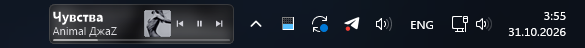
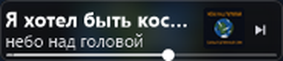
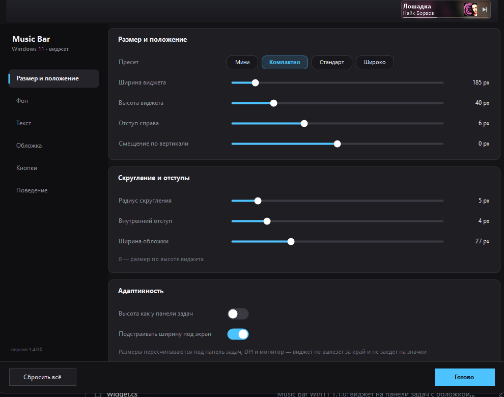
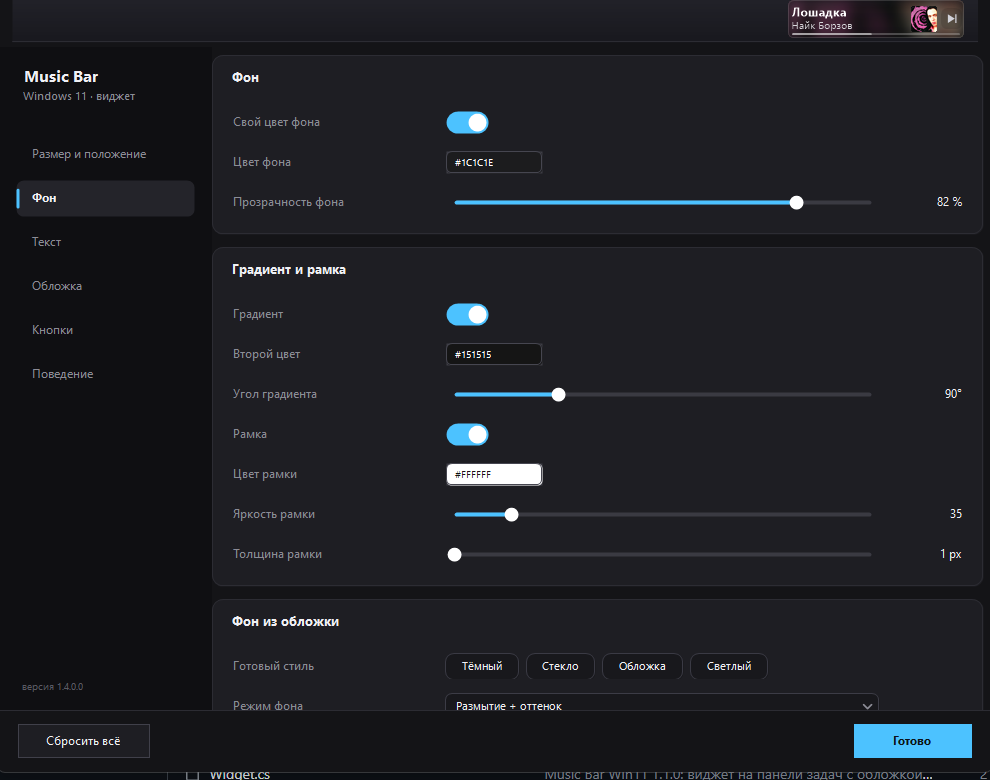
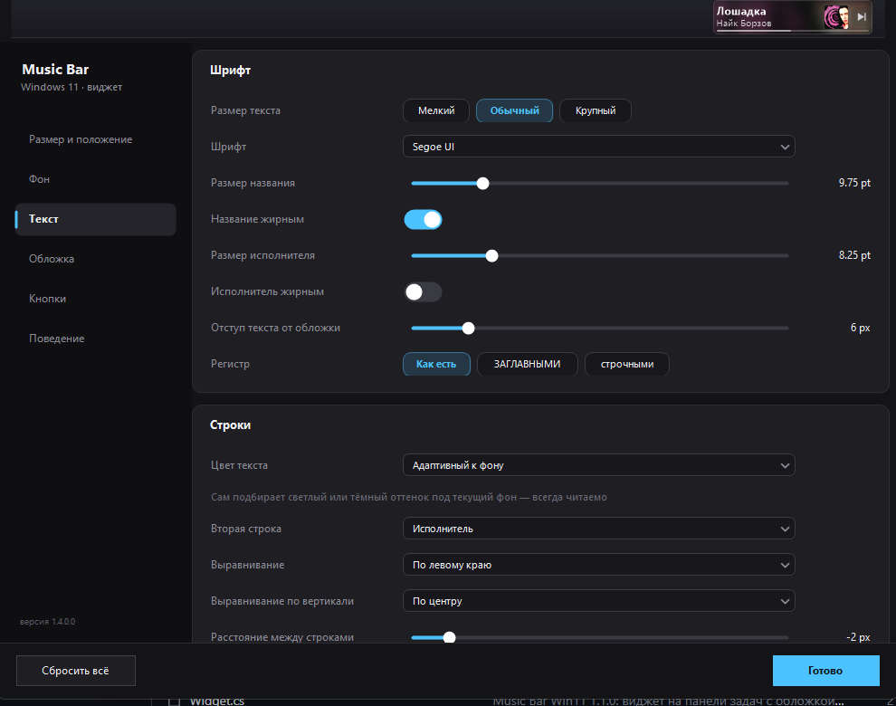
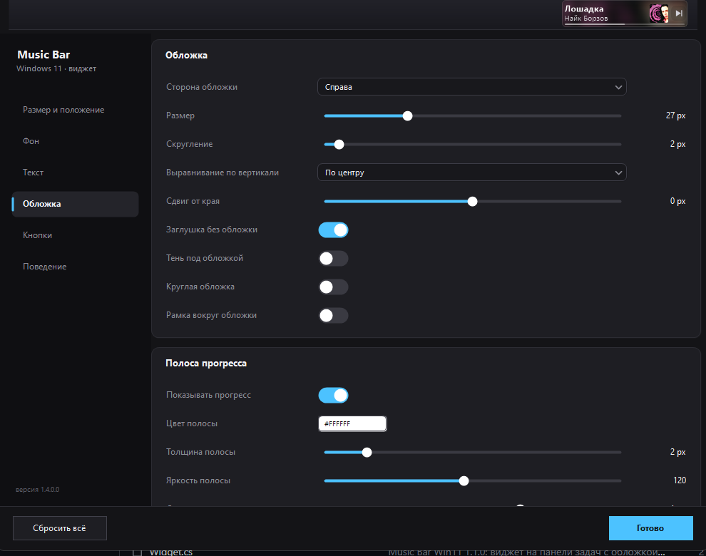
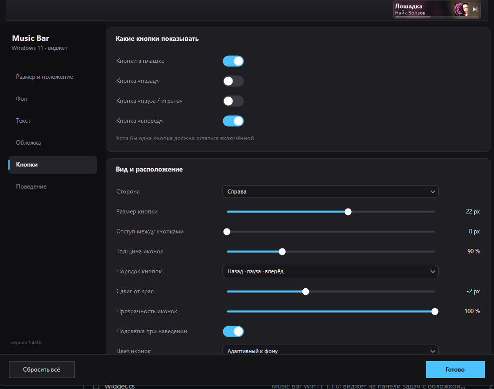
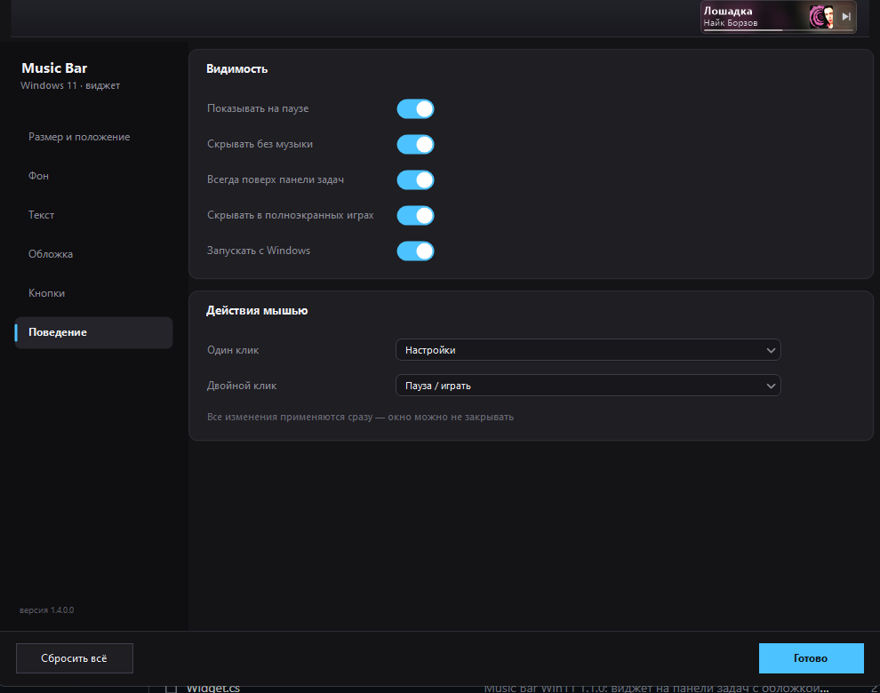

# Music Bar Win11

[](README.md) [](README.en.md)

A "now playing" strip for the Windows 11 taskbar. It sits to the left of the tray and shows
the album art, track title, artist and a progress bar. It doesn't cover taskbar buttons,
doesn't flash in the taskbar and doesn't steal focus.

**[Download for Windows](https://github.com/Joner11/music-bar-win11/releases/latest)** —
installer without admin rights, Windows 10 (1809+) and Windows 11, 64-bit.
There's a portable archive next to it if you'd rather not install anything.



## Why

Windows 11 still has no comfortable way to see what's playing without opening the player.
The tray icon only tells you which app it is, and the tooltip cuts the title down to a couple
of words. I wanted the track visible right next to the clock, without keeping a separate
always-on-top window around.

Windows exposes playback data through SMTC, so there's no need to write a player. It works
with Spotify, Yandex Music, VK, Apple Music, browsers, foobar2000, AIMP, VLC and anything else
that publishes the current track to the system.

## Screenshots

The top one is a real taskbar at 3440×1440 with 125 % scaling. Everything below is rendered
by the same code at a larger scale. The artwork in the gallery is synthetic, otherwise it
would depend on whatever was playing when the screenshots were built.


The background can come from the cover: blur, tint, or just the dominant colour of the track.


Or the other way around, light and almost invisible:


## Seeking

You can click the progress bar. A click anywhere on it jumps the track to that position,
forwards or backwards. Hovering over the bar shows where you'd land: a marker appears under
the cursor and the stretch from the current position to it lights up.



The bar itself is two pixels thin, so the hit area is extended vertically. Buttons and the
rest of the strip keep working as before, nothing gets swallowed.

Not every player supports seeking. If an app doesn't allow changing position through the
system, the click simply does nothing. CloudMus, Spotify and browsers do support it.

## Settings

Open them by clicking the strip (default), from the tray icon menu, or by launching the exe
again. Dark window with a sidebar and six sections. Everything applies immediately, there's no
"Save" button — the strip on the taskbar changes as you drag.

**Size and position.** Presets (mini, compact, standard, wide), width and height, margins,
corner radius, auto-fitting to the taskbar and screen.



**Background.** Solid colour or a two-colour gradient with an angle, opacity, border with
brightness and thickness, ready-made styles, cover-based background with blur, darkening and
saturation controls.



**Text.** Font picked from installed ones, size and weight for both lines, letter case,
alignment, line spacing, opacity, shadow and outline, marquee scrolling. The colour adapts to
the background on its own, but you can set your own.



**Cover.** Side, size, corner radius, offset, circular cover, border, shadow, placeholder when
there's no artwork. The progress bar lives here too, with its own colour, thickness, brightness
and the click-to-seek toggle.



**Buttons.** Previous, play/pause and next. Each can be enabled separately, along with side,
size, margins, icon weight and opacity, hover highlight.



**Behaviour.** Show when paused, hide without music, hide in fullscreen games, autostart,
single-click and double-click actions.



## Installation

Download `MusicBarWin11-Setup-x.y.z.exe` from [Releases](../../releases) and run it.
No administrator rights needed: the app installs into
`%LOCALAPPDATA%\Programs\Music Bar Win11` and keeps settings in
`%APPDATA%\MusicBarWin11\nowplaying.ini`. The installer has a "Start with Windows" checkbox.

If you'd rather skip the installer, take `MusicBarWin11.exe` from the portable archive, put it
wherever you like and run it. Settings will be created in `%APPDATA%` as well.

Requires 64-bit Windows 10 version 1809 or newer, or Windows 11, plus .NET Framework 4.7.2.
It's already present on both, so there's nothing extra to install. If it happens to be
missing, the installer says so up front and offers a link.

The app is display-scaling aware: at 125 % and 150 % the text stays crisp instead of being
stretched by the system.

Upgrading from an older version is just running the installer over it. Settings survive.

## Building

No Visual Studio required, `csc.exe` from the .NET Framework is enough.

```
build.cmd
```

The script locates `%WINDIR%\Microsoft.NET\Framework64\v4.0.30319\csc.exe`,
`System.Runtime.WindowsRuntime.dll` and the WinRT metadata in `%WINDIR%\System32\WinMetadata`.
The output is `MusicBarWin11.exe`.

Installer, requires [Inno Setup 6](https://jrsoftware.org/isdl.php):

```
make_installer.cmd
```

The style gallery for this README is rebuilt with `make_shots.cmd`. It's drawn by the same
`Renderer` as the strip, just at a larger scale and on synthetic artwork.

### What's where

| File | Purpose |
|---|---|
| `Config.cs` | all settings, reading and writing `nowplaying.ini` |
| `MediaApi.cs` | SMTC via reflection: track, status, artwork, timings, seeking |
| `CloudMus.cs` | reads the track from CloudMus files when the player goes silent in SMTC |
| `Json.cs` | a small JSON parser used by `CloudMus.cs` |
| `Renderer.cs` | draws the strip into a 32bpp bitmap: background, cover, text, progress, blur |
| `Widget.cs` | the taskbar window, layered drawing, player polling, mouse, tray, autostart |
| `SettingsForm.cs` | settings window: sidebar, cards, live preview |
| `Ui.cs`, `Ui2.cs` | custom controls: slider, toggle, flat dropdown, colour swatch, scrolling |
| `Shots.cs` | the README gallery generator |
| `build.cmd` | one `csc.exe` call to build everything |
| `installer.iss`, `make_installer.cmd` | Inno Setup installer |

## How it works

The app finds the taskbar (`Shell_TrayWnd`) and its notification area (`TrayNotifyWnd`), then
places the window to the left of the tray. The window is created as
`WS_EX_LAYERED | WS_EX_NOACTIVATE | WS_EX_TOOLWINDOW` and drawn through `UpdateLayeredWindow`.
Without that you can't get honest transparency with smooth edges and decent text antialiasing.

SMTC is polled every 700 ms, while drawing updates more often, for the marquee and the progress
bar. Artwork loads on a background thread. When a player doesn't hand over the image right away,
which happens a lot, the request is retried after 2 and 8 seconds. If the source switches and
returns empty for a moment, the previous track stays in place so the strip doesn't flicker.

When several players are running, the one Windows considers current is used — the one the media
keys act on. The order of sessions in the system is arbitrary, so "first in the list" doesn't
mean "the one that's playing".

## Known quirks

- On very narrow screens the widget switches to compact mode and drops the second line.
- Some apps don't publish anything to SMTC, so the strip won't show until something supported
  starts playing.
- If the taskbar is packed with pinned apps and barely has room left, the strip may not fit
  between the buttons and the tray. Lowering the width or shifting it left helps.
- Click-to-seek depends on the player. If it can't change position through the system,
  nothing will happen.
- CloudMus 0.6.4 stopped publishing title and artist to the system. The widget picks them up
  from the player's own files, but if the developers change that file format, "No title" will
  be shown until the widget is updated.

## License

MIT, see [LICENSE](LICENSE).
