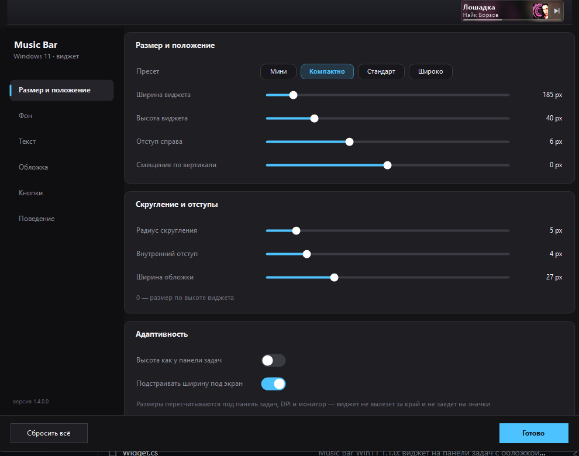
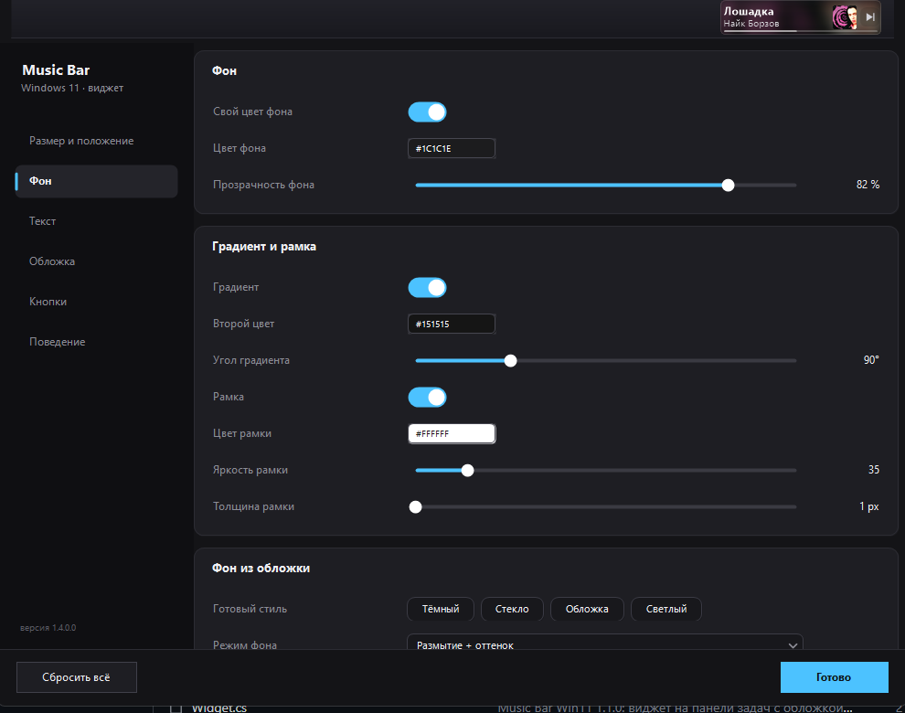
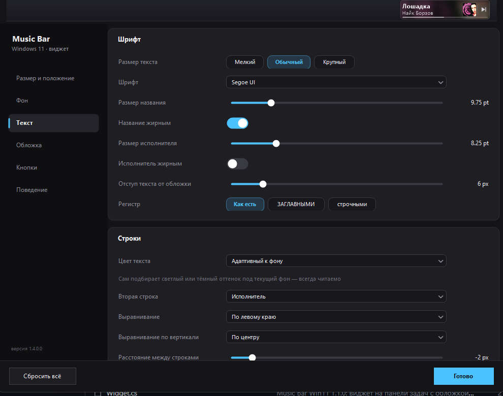
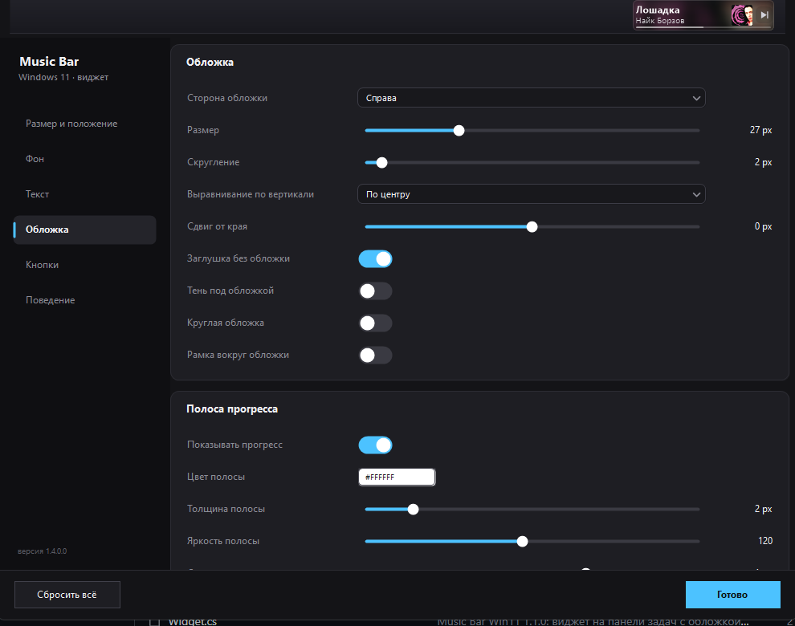
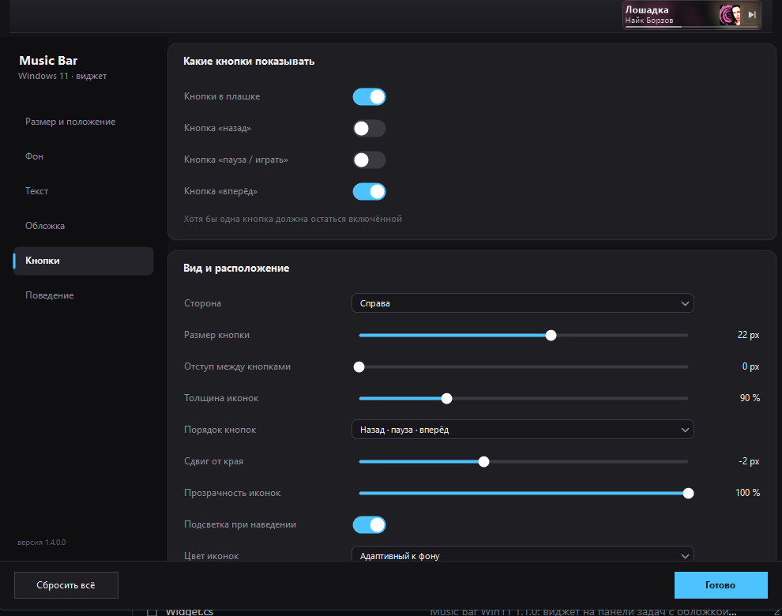
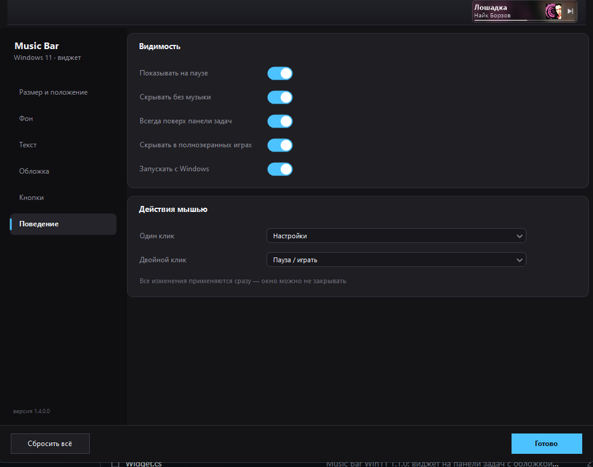

# Music Bar Win11

[](README.md) [](README.en.md)

Плашка «сейчас играет» на панели задач Windows 11. Стоит слева от трея, показывает обложку,
название трека, исполнителя и полосу прогресса. Кнопки панели задач не перекрывает, в таскбар
не мигает, фокус не забирает.


## Зачем

В Windows 11 до сих пор нет удобного способа посмотреть, что играет, не открывая плеер.
Значок в трее показывает только приложение, подсказка при наведении обрезает название
до пары слов. Хотелось, чтобы трек было видно сразу у часов, и чтобы для этого не нужно
было держать поверх всех окон отдельное окно.

Windows отдаёт данные о воспроизведении через SMTC, так что свой плеер писать не надо.
Работает со Spotify, Яндекс Музыкой, VK, Apple Music, браузерами, foobar2000, AIMP, VLC
и всем остальным, что публикует трек в систему.

## Как выглядит

Сверху настоящая панель задач, 3440×1440 при масштабе 125 %. Ниже варианты оформления,
отрисованные тем же кодом в увеличенном масштабе. Обложки в галерее синтетические,
иначе она зависела бы от того, что играет в момент сборки скриншотов.


Фон можно взять из обложки: размытие, оттенок или просто доминирующий цвет трека.


Или наоборот, светлый и почти незаметный:


## Перемотка

По полосе прогресса можно кликать. Клик в любом месте ставит трек на нужную позицию,
работает и вперёд, и назад. При наведении на полосу видно, куда попадёшь: в точке курсора
появляется метка, а от текущей позиции до неё подсвечивается отрезок.


Сама полоса тонкая, в две точки, поэтому зона попадания по ней расширена по вертикали.
Кнопки и остальная плашка при этом работают как раньше, ничего не перехватывается.

Перемотку умеют не все плееры. Если приложение не поддерживает смену позиции через систему,
клик просто ничего не сделает. CloudMus, Spotify и браузеры умеют.

## Настройки

Открываются кликом по плашке (по умолчанию), из меню значка в трее или повторным запуском exe.
Тёмное окно с боковым меню, шесть разделов. Всё применяется сразу, кнопки «Сохранить» нет,
плашка на панели задач меняется в процессе.

**Размер и положение.** Пресеты (мини, компактно, стандарт, широко), ширина и высота,
отступы, скругления, автоподстройка под панель задач и экран.



**Фон.** Свой цвет или градиент из двух цветов с углом, прозрачность, рамка с яркостью
и толщиной, готовые стили, фон из обложки с настройкой размытия, затемнения и насыщенности.



**Текст.** Шрифт из списка установленных, размеры и жирность обеих строк, регистр,
выравнивание, межстрочный интервал, прозрачность, тень и обводка, бегущая строка.
Цвет подстраивается под фон сам, но можно задать свой.



**Обложка.** Сторона, размер, скругление, сдвиг, круглая обложка, рамка, тень,
заглушка если обложки нет. Здесь же полоса прогресса со своим цветом, толщиной,
яркостью и переключателем перемотки по клику.



**Кнопки.** Назад, пауза и вперёд. Каждую можно включить отдельно. Вместе с ними сторона,
размер, отступы, толщина и прозрачность иконок, подсветка при наведении.



**Поведение.** Показывать на паузе, скрывать без музыки, скрывать в полноэкранных играх,
автозапуск, действия по клику и двойному клику.



## Установка

Скачать `MusicBarWin11-Setup-x.y.z.exe` из [Releases](../../releases) и запустить.
Права администратора не нужны: программа ставится в `%LOCALAPPDATA%\Programs\Music Bar Win11`,
настройки лежат в `%APPDATA%\MusicBarWin11\nowplaying.ini`. В установщике есть галочка
«Запускать с Windows».

Если установщик не нужен, берите `MusicBarWin11.exe` из portable-архива, положите куда удобно
и запустите. Настройки создадутся там же, в `%APPDATA%`.

Нужен Windows 10 версии 1809 или новее, либо Windows 11, и .NET Framework 4.7.2.
На Win10 и Win11 он уже стоит.

Обновиться с прошлой версии можно тем же установщиком, поверх. Настройки не потеряются.

## Сборка

Visual Studio не требуется, хватает `csc.exe` из .NET Framework.

```
build.cmd
```

Скрипт сам находит `%WINDIR%\Microsoft.NET\Framework64\v4.0.30319\csc.exe`,
`System.Runtime.WindowsRuntime.dll` и метаданные WinRT в `%WINDIR%\System32\WinMetadata`.
На выходе `MusicBarWin11.exe`.

Установщик, нужен [Inno Setup 6](https://jrsoftware.org/isdl.php):

```
make_installer.cmd
```

Галерея стилей для этого README пересобирается через `make_shots.cmd`. Она рисуется
тем же `Renderer`, что и плашка, только в увеличенном масштабе и на синтетических обложках.

### Что где лежит

| Файл | Что делает |
|---|---|
| `Config.cs` | настройки и чтение-запись `nowplaying.ini` |
| `MediaApi.cs` | SMTC через рефлексию: трек, статус, обложка, тайминги, перемотка |
| `CloudMus.cs` | читает трек из файлов CloudMus, когда плеер молчит в SMTC |
| `Json.cs` | маленький парсер JSON для `CloudMus.cs` |
| `Renderer.cs` | рисует плашку в 32bpp bitmap: фон, обложка, текст, прогресс, размытие |
| `Widget.cs` | окно на панели задач, слоистая отрисовка, опрос плеера, мышь, трей, автозапуск |
| `SettingsForm.cs` | окно настроек: боковое меню, карточки, живой предпросмотр |
| `Ui.cs`, `Ui2.cs` | свои контролы: ползунок, переключатель, плоский список, образец цвета, прокрутка |
| `Shots.cs` | генератор галереи для README |
| `build.cmd` | сборка одним вызовом `csc.exe` |
| `installer.iss`, `make_installer.cmd` | установщик Inno Setup |

## Как это работает

Программа находит панель задач (`Shell_TrayWnd`) и её область уведомлений (`TrayNotifyWnd`),
ставит окно слева от трея. Окно создаётся как
`WS_EX_LAYERED | WS_EX_NOACTIVATE | WS_EX_TOOLWINDOW` и рисуется через `UpdateLayeredWindow`,
иначе не получить честную полупрозрачность с гладкими краями и нормальный антиалиасинг текста.

Раз в 700 мс опрашивается SMTC, отрисовка обновляется чаще, для бегущей строки и прогресса.
Обложки грузятся в фоновом потоке. Когда плеер не сразу отдаёт картинку, а он часто не сразу,
запрос повторяется через 2 и 8 секунд. Если источник переключился и на мгновение вернул пусто,
старый трек остаётся на месте, чтобы плашка не мигала.

Из нескольких запущенных плееров берётся тот, который Windows считает текущим, то есть тот,
на который действуют медиа-клавиши. Порядок сессий в системе произвольный, поэтому «первая
в списке» не значит «та, что играет».

## Известные мелочи

- На очень узких экранах виджет уходит в компактный режим и не показывает вторую строку.
- Некоторые приложения не публикуют данные в SMTC, тогда плашки не будет, пока не заиграет
  что-то из поддерживаемых.
- Если в панели задач много закреплённых приложений и она заполнена почти под ноль,
  плашке может не хватить места между кнопками и треем. Лечится уменьшением ширины
  или сдвигом влево.
- Перемотка по клику зависит от плеера. Если он не умеет менять позицию через систему,
  ничего не произойдёт.
- CloudMus версии 0.6.4 перестал отдавать название и исполнителя в систему. Виджет
  подхватывает их из файлов плеера, но если разработчики поменяют формат этих файлов,
  покажется «Без названия» до следующего обновления виджета.

## Лицензия

MIT, см. [LICENSE](LICENSE).
